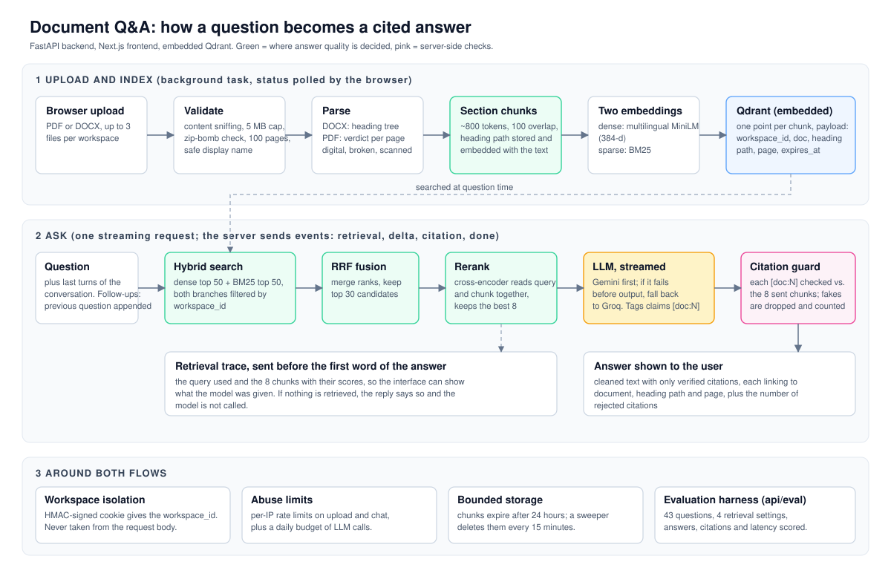

# Internal Document Assistant

Upload an SOP or handbook, then ask questions about it. Every answer points back
to the section of the document it came from, and any citation that does not
match is dropped by the server before it reaches the screen.

Running cost is zero: free-tier model, local embeddings, embedded vector store.

---

## Why this is not another "chat with your PDF"

**Chunking follows the document's structure.** Chunks split at heading
boundaries, not every 512 tokens. The heading path (`4. Leave › 4.2 Annual
Leave`) is embedded with the chunk, so a short section still carries its
context.

**Hybrid retrieval.** Dense search (a multilingual MiniLM sentence model) captures meaning. BM25
captures document codes and exact terms such as `SOP-HR-014`. The two are fused
with RRF, then a cross-encoder reranks down to 8 chunks.

**Validated citations.** The model tags its claims with `[doc:N]`. The server
checks every N against the context that was actually sent and drops the ones
the model invented. The number of rejected citations is shown on screen: a
count, not a claim.

What gets rendered is the validated text from the server, not the raw token
stream. If the UI rendered raw deltas, an invented marker would still be visible
to the user even though the API had already rejected it.

**OCR router.** Each PDF page is classified on its own: digital, scanned, blank,
or broken text layer. Only the pages that need it go to the OCR queue.

**Tenant isolation.** `workspace_id` comes from an HMAC-signed cookie, never
from the request body, and is filtered in both retrieval branches.

---

## Architecture



## Stack

| Layer | Choice |
|---|---|
| LLM | Gemini 3.6 Flash, automatic fallback to Groq on 429/5xx |
| Embedding | `paraphrase-multilingual-MiniLM-L12-v2` (384-dim), local on CPU |
| Reranker | `mmarco-mMiniLMv2-L12`, local |
| Sparse | `Qdrant/bm25` |
| Vector store | Qdrant embedded |
| Backend | FastAPI + `uv` |
| Frontend | Next.js 16, Tailwind |

Set `LLM_PROVIDER=anthropic` to run on Claude with native citations, or
`LLM_PROVIDER=openai` for GPT-6 Luna (paid, no free tier).

The UI has an Indonesian and an English mode. The sample SOP is in Indonesian.

---

## Running it

```bash
cp .env.example .env
```

Fill in `.env` (not `.env.example`, which is a template that gets committed):

- `GEMINI_API_KEY` from <https://aistudio.google.com/apikey>
- `SESSION_SECRET`: `python -c "import secrets; print(secrets.token_urlsafe(32))"`

`GROQ_API_KEY` is optional; without it failover is off but the app runs.

```bash
# backend
cd api && uv sync --extra dev
uv run uvicorn app.main:app --reload

# frontend, in another terminal
cd web && npm install && npm run dev
```

Open <http://localhost:3000> and click **Use the sample SOP**.

Full test guide: **[TESTING.md](TESTING.md)**.

If Gemini rejects the request with 404 `model is no longer available`, list the
models available to your key and update `GEMINI_MODEL`:

```bash
cd api && uv run python -c "from google import genai; from app.config import settings; [print(m.name) for m in genai.Client(api_key=settings.gemini_api_key).models.list()]"
```

### Evaluation

`api/eval` measures the pipeline instead of describing it. The corpus is four
Indonesian DOCX SOPs (the sample leave policy plus three synthetic ones, 43
chunks) and 43 questions: 35 answerable (exact codes, paraphrases, near-duplicate
sections such as the 5-day travel deadline vs the 7-day leave deadline, English
questions on Indonesian documents) and 8 whose answer is not in the documents.

```bash
cd api
uv run python -m eval.run --retrieval-only   # no LLM key needed
uv run python -m eval.run                    # adds answers, citations, latency
```

Retrieval, answerable questions only, top 8 chunks:

| Setting | hit@1 | hit@3 | hit@8 | MRR |
|---|---|---|---|---|
| Dense only | 71.4% | 88.6% | 97.1% | 0.82 |
| BM25 only | 71.4% | 77.1% | 82.9% | 0.75 |
| Dense + BM25 (RRF) | 71.4% | 91.4% | 100% | 0.83 |
| RRF + cross-encoder (what the app runs) | 80.0% | 97.1% | 100% | 0.89 |

Answers (Groq `openai/gpt-oss-120b`, scored by string match, no LLM judge):
35/35 answerable correct, 8/8 abstained when the answer is not in the documents,
0 false abstentions, 41 citations accepted and 0 rejected by the guard, median
latency 3.3 s (p90 6.0 s).

What it shows, and what it does not:

- Hybrid beats either retriever alone, and the reranker adds the most at rank 1.
  BM25 alone is the best at exact codes (100% hit@1) and gets 0% on English
  questions; the reranker gives some of the code advantage back (exact-code
  hit@1 0.5 in the production setting). That is a real weakness, not fixed yet.
- The set is small and written by me, so hit@8 is easy (8 of 43 chunks is 19% of
  the corpus). Read hit@1 and MRR. Treat all numbers as a regression check, not a
  benchmark.
- Scoring is regex matching. My first run scored 34/35 and 5/8; all four
  misses were scorer false negatives (a "US $50" spacing and "tidak terdapat"
  phrasing), found by reading every answer, and the patterns were then widened.
  Every answer is kept in `eval/results/latest.json` so this can be checked.
- The failover chain was not exercised: the Gemini key available when I ran
  this was invalid, so all answers came from the Groq fallback.
- The first run exposed a guard gap: gpt-oss writes the tag in full-width
  brackets, which the parser did not recognise (2 of 35 answers lost their
  citation). The guard now folds them to ASCII before validating; the numbers
  above are from the re-run.

### Tests

```bash
cd api && uv run pytest -q      # 62 tests
```

Coverage: router verdicts (4 categories), PDF/DOCX parsers against real
fixtures, chunking and heading paths, asymmetric embedding prefixes, tenant
isolation, and the citation guard.

---

## Public demo security

The most important control: **do not enable billing** on the Google Cloud
project. Free tier means the quota runs out, not that you get a bill.

| Threat | Control |
|---|---|
| Documents leaking between users | HMAC-signed cookie, filter in both branches, covered by a test |
| Zip bomb / huge files | 5 MB cap, 3 files, 100 pages, decompression ratio limit |
| Scripts hammering the endpoint | Turnstile + rate limits per IP, session and globally |
| Quota exhaustion | Daily ceiling + kill switch |
| Prompt injection through a PDF | Document text wrapped in delimiters; the bot has no tools |
| Pathological PDFs | 30-second parse timeout, encrypted files rejected |

CORS is not a security control: `curl` ignores CORS. Only Turnstile and rate
limits stop scripts.

The blast radius of a prompt injection is small because the bot has no tools at
all: the worst outcome is nonsense text in the attacker's own session, gone
within 24 hours.
